# oct 18

Ok started my img editor , i wrote a minimal main.rs to js pop up , and select png and then export it . Nothing else , it works , i used egui for native rust support and thts all gonna bump a lot of pics now out of nowhere 

The build took a lot , really a lot of time(because i am low on internet for now , yk so called family "vacation")  

---
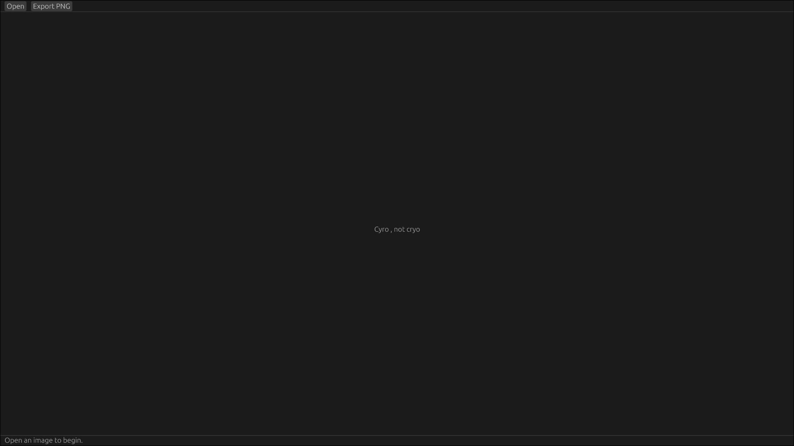
---
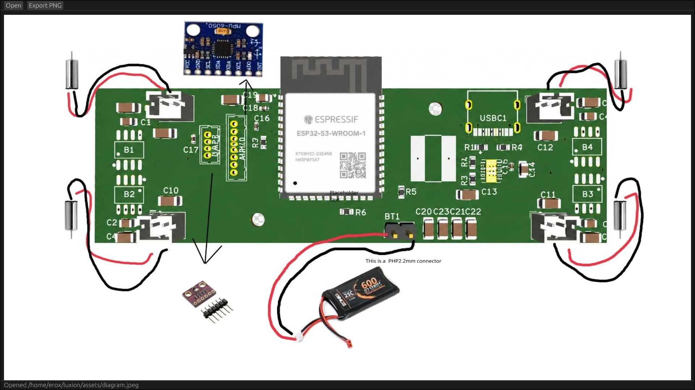
dont worry abt the pic , ik i draw worse than even orphy lol
---
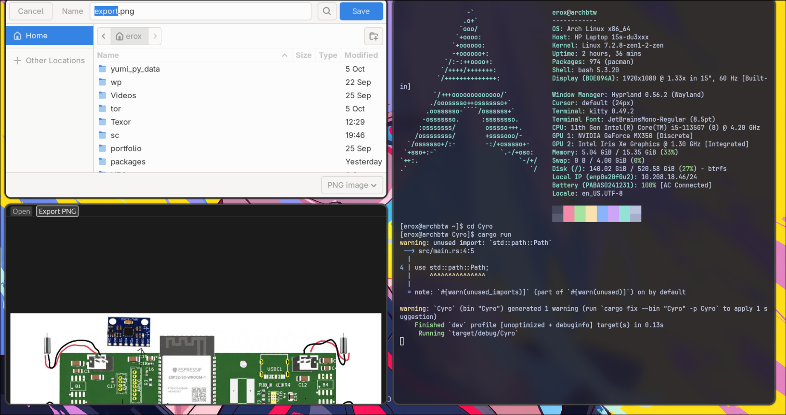
---

thts all for this commit 

ok next commit , broke the main.rs into parts done , i am goin to sleep now .

# oct 19

ok started with the ui.rs today , added 2 files , crp and esrgan , also ui.rs needs a really lot of work , but i suck in ui so what can i do now? maybe ai? but thts against my moto , then how abt copy frm other open source ? nah others arent tht much obbsessed with rust like me , ahhhhh! 

anyways this push contains a very basic version by deepseek (i cant do frontend frm scratch yk ) , the crp function is shit , i will fix tht but i suck in ui ah!

anyways did most of the work myself so shldnt be a prob , also the crop mode is default for now lol 

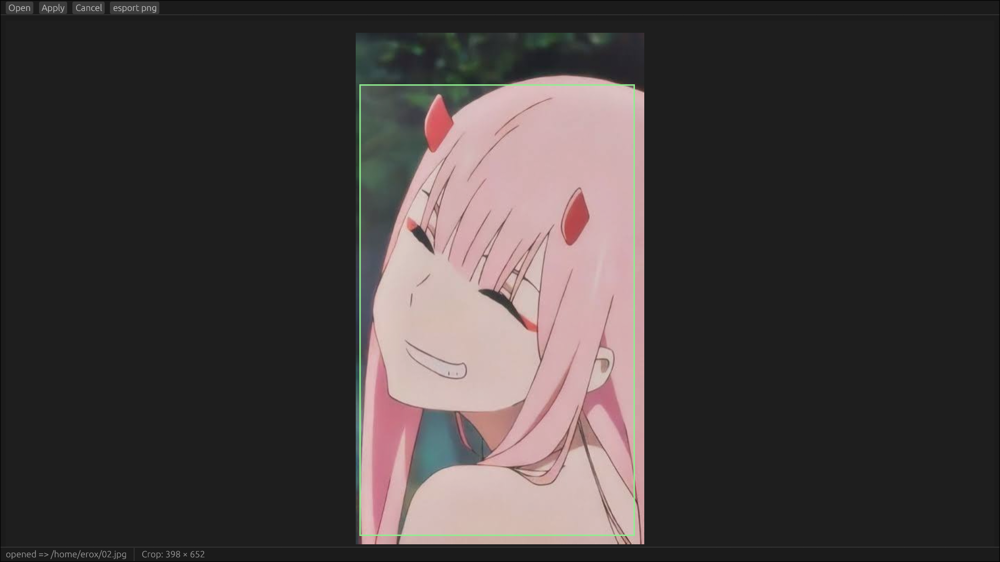

yeah its zero two , got any problem?

ok done , now next commit ,

i think this time i will change the crop thing , as i think the old one absolutely nuts ,

i think the app.rs is getting bigger so lets break it apart first 


okk completely broke it apart , got a good fs too 

```
src
├── bak.rs
├── crp.rs
├── esrgan.rs
├── img_wrk.rs
├── main.rs
├── ui
│   ├── bar.rs
│   ├── bkgnd.rs
│   ├── lgc.rs
│   └── mod.rs
└── ~ui.rs

2 directories, 10 files

```

also the proj works fine now , i am really glad , i broke it and didnt let deepseek cook , as i fixed the crop things myself , deepseek for frontend only 
and now it works pretty good , but but theres a prob , the last lgc(logic).rs is too big so i think i will split it on lgca , b,g,d [alpha beta gamma delta] on diff parts and then write the esrgan portion , as i dont like long codes , the logic was mosly written by me , or to be more precise , written by me earlier and scraped out frm the old ~ui.rs file , so now imma gonna add the esrgan , its not like i did nothing on frontend , i did but very less , mostly debugging not even wrote a single line , anyways , hackatime is the proof so idc , the bkgnd.rs may be a lil slop but i accept i didnt write it myself hands off

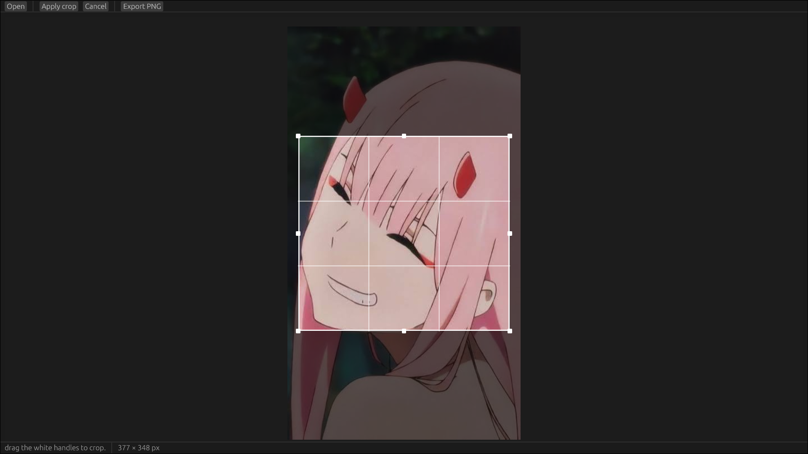

anyways , fixed the probs , now i think esrgan will pull the rest repo , and i dont have any else feature in mind .

ok done , splitted the lgc.rs , it took me a lot of time , and now wow errs , i am cursed 

ok fixed the bugs also named the buttons with the 1st letter in capital like apply => Apply as it looks better (does it actually? well kind of for me it looks normal)

# oct 20

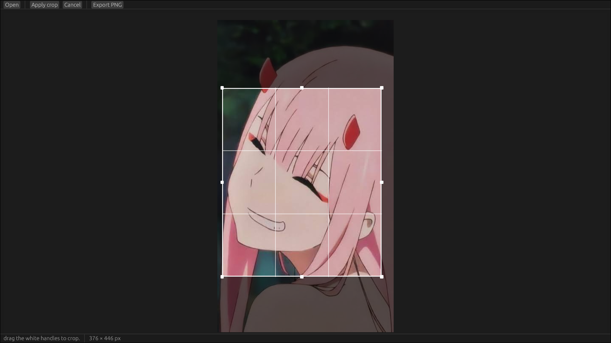

also after a lot of work i reakized splitting is a part of my hobby so i will split everything buhahahah , anyways the igc and ui were same file onve  `<skull emoji>` holy its 5 hrs today already???? imma gonna grind , i am on a so called family vacation where youre forced to tag so no way imma gonna waste this free time .

okk back after a 2 hrs break , i think now imma gonna integrate esrgan? yeah probably esrgan 

oh started the esrgan , i am js executing commands on terminal , no actual thing and after getting builied by rust a bit got this 

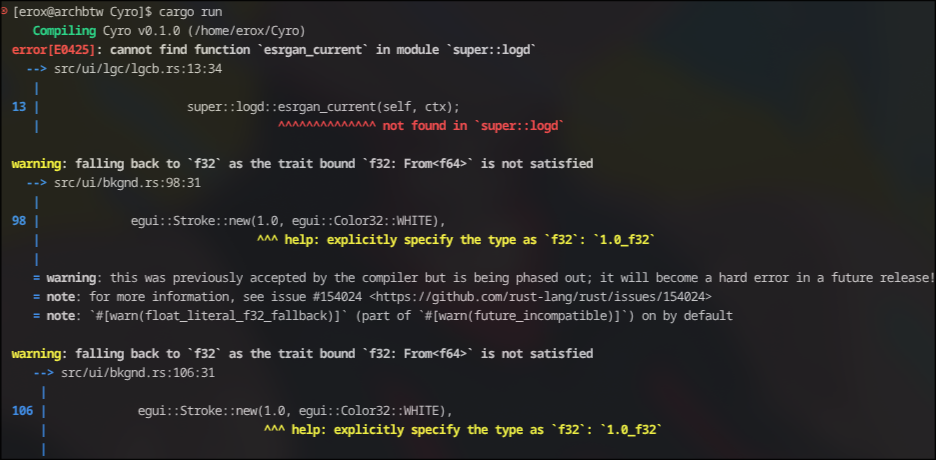

lol , but rest works . wait , idk if rest works <T_T> 

anyways , lemme fix the super prob 

ahh it works now but before upscalling , ik there were a lil bit ai , like the drag mode(lowkey i dont get those things) but rest was mine , so why cant i find the default struct i made to set scaling on 4 ?

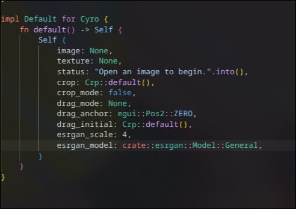

finally found this brat 

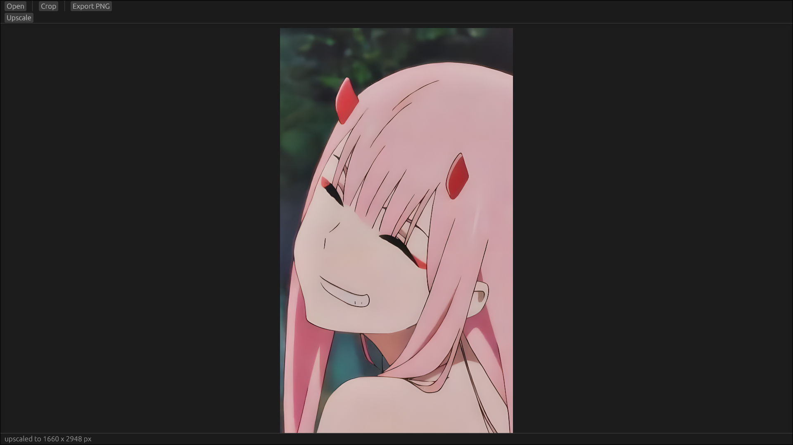

ohhh now it upscales , js needa wait a lot , i think i needa add a progress bar 

ok so while adding a progress bar i though i wd organize the code , last words frm many programmers and then 

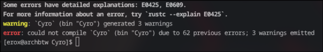

booom ! now i wanna die , i didnt even push my last working one and i already have strippe vs code to minimal so no ~.bak taken of code  i js wanna die now 

ok fixed a lot , all bugs fixed , then i started making , everything works but the progress bar never shows up , WHYYYYYYY????!!!!

ok got the best idea at this dire situation , drop the processing thing , and FUCKING LET IT COOOK , it will still upscale despite no processing tag , what we are? humans not bots , right , RIGHT? so we can wait not  prob no loading screen needed also , my arch throws terminate / wait when it does the work PLZ IGNORE THT .

ok done i am fucking tired , imma gonna write the readme now and sayonara 

i gave on my coding skills and asked gpt to fix and he was unable to do it , he js added slop and more progress bars IT FUCKING STACKED $ PROGRESS BARS , T_T i am crying 

but then i saw my impl sets esr_run true only after esrgan does the work so you get a terminate/wait msg as things never load for the backend , who the hell wrote it? it was me obviously , thts why i am crying 
 T-T  

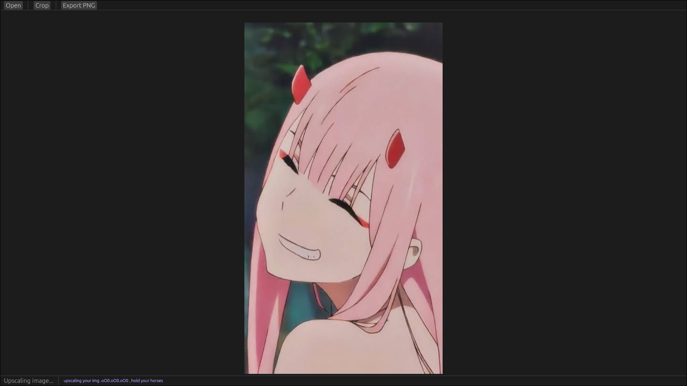

btw the .oO0 looks really odd , needa fix tht , okk done now it works js ignore tht one msg tht shldnt be there , i think people can ignore one wait/terminate msg right? yeah probably .

ok time for benhmark

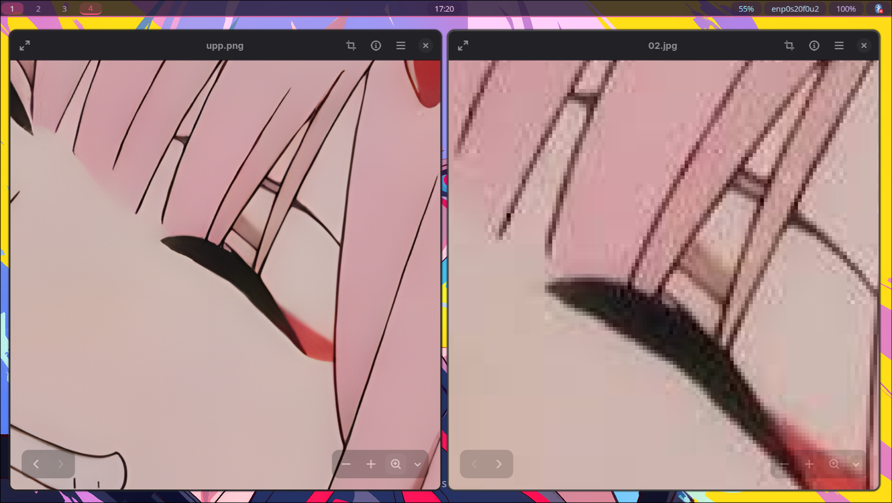

i won at last, now js the readme and i am done 

ok it even works on PKGBUILD now its a full on prod 

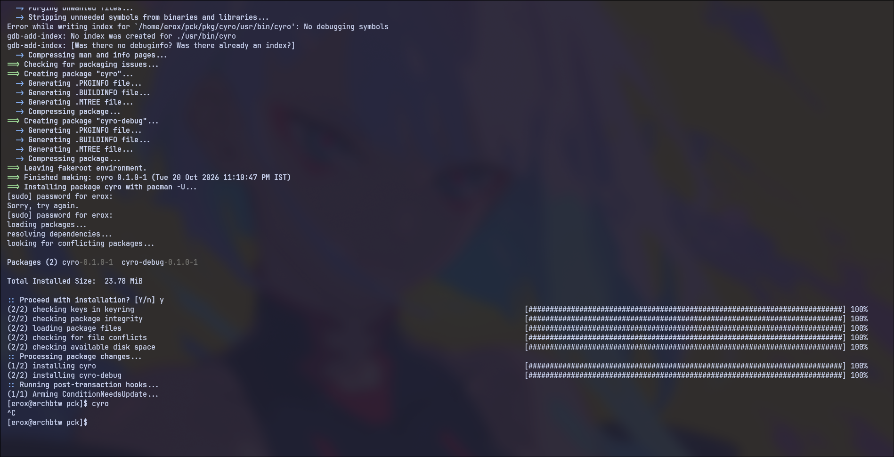

ok done so i can now push it to phantom , ah !