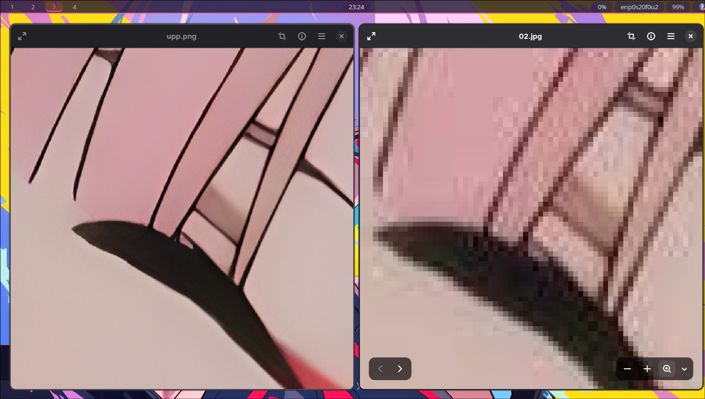
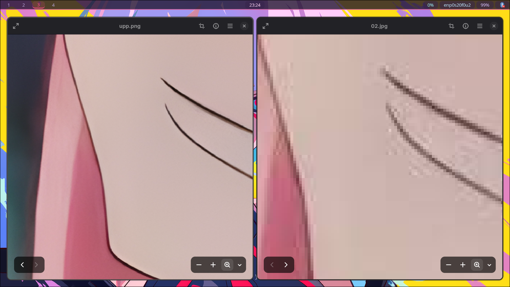
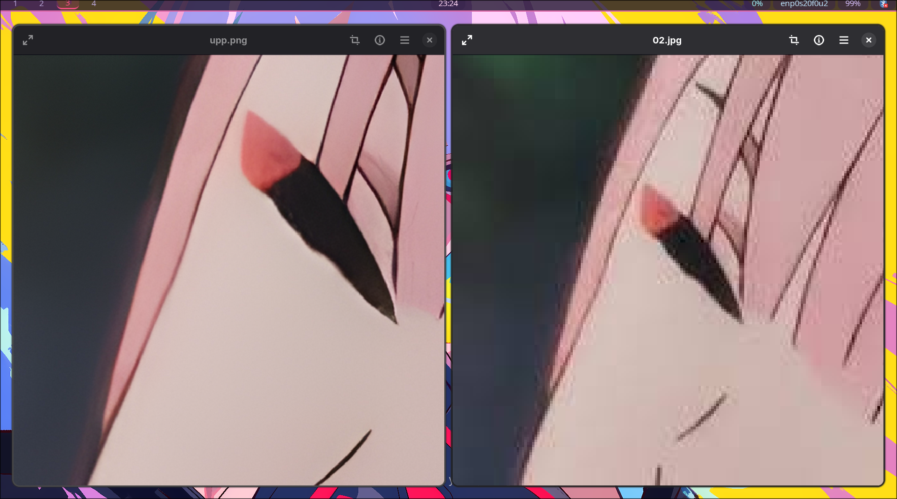

# CYRO

A simple photo editor , but in rust also IT HAS A UPSCALER

## features

- png , jpeg , jpg support 
- crop the images
- backup before editing anything 
- upscale imgs 

## process

it uses eframe and egui for the gui, and the image crate for image loading, processing, and saving. and 
for cropping , it is done by mainly the `crp.rs` in `./src` also abt the upscaler , its a process runs on terminal , 
cyro js handles the command to run it on terminal .

## requirement

- Rust and Cargo
- `realesrgan-ncnn-vulkan` for upscaling (frm aur)

# Installation 

we gonna use `wget` to fetch the PKGBUILD so make sure to make a separate dir at first !!

```sh
mkdir cryo-in
cd cyro-in

wget "https://github.com/Erox-02/Cyro/releases/download/v1/PKGBUILD"

makepkg -si
```

and then `cyro` to use .

# Results 


Here are some results on upscaling :
---

---

---

---

# Limits / Plan for v2

> Cant open a passed photo
> doesnt have anything else after crop and upscale
> works only on arch
> written realy measily

# License 

gpl 3.0 only